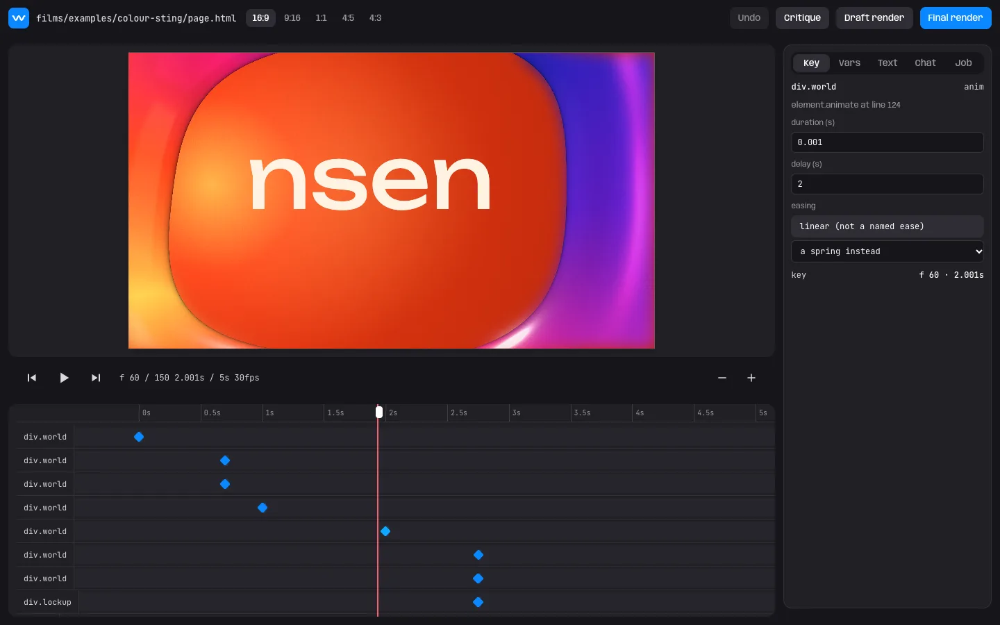

<p align="center">
  <a href="https://vawe.dev"></a>
</p>

<p align="center">
  <a href="https://github.com/vawe-hq/vawe/blob/main/LICENSE"></a>
  <a href="https://github.com/vawe-hq/vawe/stargazers"></a>
  <a href="https://github.com/vawe-hq/vawe/commits/main"></a>
  <a href="https://nodejs.org"></a>
  <a href="https://github.com/vawe-hq/skills"></a>
</p>

<p align="center"><b>HTML ページを 1 枚書けば、mp4 が 1 本できる。</b></p>

<p align="center">
  <a href="https://vawe.dev">vawe.dev</a> |
  <a href="https://vawe.dev/docs">ドキュメント</a> |
  <a href="https://github.com/vawe-hq/vawe/discussions">ディスカッション</a> |
  <a href="https://github.com/vawe-hq/skills">Skills</a>
</p>

# vawe: コーディングエージェントのための HTML から動画への変換

[English](README.md) | [简体中文](README.zh-CN.md) | 日本語

vawe は、エージェントネイティブなモーショングラフィックスのためのオープンソースの HTML 動画化フレームワークです。
HTML ページを 1 枚入力すると、映像が 1 本出力されます。動画とモーショングラフィックスをコードとして書くもので、
Remotion、HyperFrames、Motion Canvas の無料の代替になります。コーディングエージェント（Claude Code、Codex、Cursor）が
映像を書くことを前提に作られています。
ページは普通の HTML、CSS、Web Animations、SVG、canvas、three.js です。レンダラーは Chrome 上でページを 1 フレームずつ
シーク（seek）し、`<audio>` タグをオフラインでミックスして、決定的な mp4 を 1 本エンコードします。

サイトとドキュメント: [vawe.dev](https://vawe.dev)。AI エージェント向け: [vawe.dev/ai-agents](https://vawe.dev/ai-agents)
または [llms.txt](https://vawe.dev/llms.txt)。


## クイックスタート

```bash
npm install @vawe/cli
npx vawe new my-film --request "a 10 second title card"
npx vawe dev films/my-film/page.html
```

Node 22 以上と、PATH 上の ffmpeg が必要です。映像は `films/` に、mp4 は `out/` に、コマンドを実行したフォルダの中に作られます。
最初のレンダリングで Chrome を一度だけ取得します（約 150 MB）。パッケージ名は `@vawe/cli`、コマンド名は `vawe` です。`npx vawe --help` でサブコマンドの一覧が出ます。
ドキュメント中の `bin/vawe` は `npx vawe` と読み替えてください。

ソースから実行する場合（vawe 自体の開発用）:

```bash
git clone https://github.com/vawe-hq/vawe.git && cd vawe
npm install                                  # Node 22+; ffmpeg must be on PATH
npx puppeteer browsers install chrome        # bin/vawe-dev doctor prints this and every other missing tool
bin/vawe new hello --request "a 10 s sting for a coffee brand"
# then run the next: line that each command prints (AGENTS.md is the map)
```

## Studio: 映像を手で直す

```bash
bin/vawe dev films/<name>/page.html --studio    # open the printed address
```

1 ページ用のライブエディタです。映像をスクラブし、タイムライン上でキーをドラッグし、色やテキストを変え、
アスペクト比を切り替えられます。編集はすべて `page.html` へのテキストパッチなので、エージェントは同じファイルで作業を続けられます。
詳しくは [vawe.dev/studio](https://vawe.dev/studio) と `studio/README.md` を見てください。



## vawe で作られた映像

どの映像も `page.html` 1 枚です。静止画をクリックすると mp4 が再生されます。

| | |
|---|---|
| [](https://vawe.dev/examples/showcase.mp4) | [](https://vawe.dev/examples/cindre.mp4) |
| **showcase**、14 秒: 1 枚のページを 16:9、9:16、1:1、4:5、4:3 にレンダリング | **CINDRE**、10 秒: 香水の映像、ページ 1 枚 |
| [](https://vawe.dev/examples/tracking-hud.mp4) | [](https://vawe.dev/examples/retro-remix.mp4) |
| **tracking HUD**: レンズシェーダー越しに撮った画面（`films/examples/tracking-hud/`） | **retro remix**: デスクトップウィンドウ風のリミックス |

ほかにも、そのままコピーして使える 120 以上のムーブ（move）が、それぞれクリップ付きで [vawe.dev/moves](https://vawe.dev/moves)
と `prompts/moves/README.md` にあります。

## 仕組み

### 映像は HTML ページ 1 枚

```html
<!doctype html>
<meta name="duration" content="6">
<meta name="message" content="one page, one film">
<style>
  body { margin: 0; background: #0b0d12; color: #f4f6fb; font: 700 calc(var(--vh) * 0.08) system-ui; }
  h1 { position: absolute; left: 8%; top: 40%; animation: rise 0.6s var(--ease-land) both 0.4s; }
  @keyframes rise { from { transform: translateY(40px); opacity: 0 } to { transform: none; opacity: 1 } }
</style>
<h1>one page, one film</h1>
<audio data-synth="chime" data-at="0.4" data-gain="-6"></audio>
```

- `<meta name="duration">` は秒単位の長さです。それ以外は、すでに知っているものばかりです。
- 時間はシークです。CSS `@keyframes` と `element.animate()` は一時停止され、`currentTime` で動かされます。
  または `window.seek(t)` を定義し、フレーム t を t の純粋関数として描画します。
- ページのスクリプトが動く前に、レンダラーが仮想クロックを入れます（`Date`、`performance.now`、
  `requestAnimationFrame`、タイマー、シード付きの `Math.random` がすべてシークに従います）。さらに
  `<html data-aspect>`、`--vw`/`--vh`、`window.vawe` を設定するので、1 枚のページを `16:9 9:16 1:1 4:5 4:3`
  に合わせてレイアウトできます（`bin/vawe ship <page> --aspect all` で全比率をレンダリングします）。
- 名前付きのイージングも CSS 変数です。入ってくる動きには `var(--ease-land)`、出ていく動きには `var(--ease-launch)` を使います。
  レンダラーと studio がこれらを設定します。通常のブラウザでは設定されないので、そこではページは動きなしで最終状態を表示します。
- 音声は `<audio>` タグで、`data-at`、`data-gain`、`data-fade-out` を使います。`loop` はユーザーが渡した音楽ファイルを示します。
  `data-synth` は `core/audio/kit.mjs` から代替の効果音の声を選びます（録音した効果音が優先です）。
  ミックスはオフラインで、書いたとおりに行われます。`<meta name="loudness">` で目標ラウドネスを有効にできます。
- スプリング、キーフレームテーブル、シード付きノイズ: `core/motion/springs.js`（`core/motion/README.md`）。

契約の全体と、最初のドラフトでよくある間違いは `skills/vawe-page/SKILL.md` にあります。上の例では、行がフェードインしながら 40 px 上がり、
読めるだけの間そこに留まり、チャイムが動きに合わせて鳴ります。

### ループ

```
brief -> reference study -> design and kit -> key frames -> board -> draft -> motion pass
      -> critique in a FRESH session -> fix the named seconds -> owner approval -> final
```

`bin/vawe` が唯一のコマンドです。主なサブコマンド（`bin/vawe --help`。`--help --all` で全サブコマンドを一覧できます）:

| verb | 内容 |
|---|---|
| `new` | 映像を始める: `page.html` と `brief.md` を書き出し、足りない事実を先に尋ねる |
| `refs`, `see` | 参考映像を調べ、映像を数値として読む: ショット、動き、光、文字、音 |
| `frame` | あらゆる画像: 1 フレーム、コンタクトシート、各 world のキー状態、カット、ムーブ、ズーム、HTML ボード |
| `dev` | ドラフト: 半分のサイズ、30 fps |
| `critique` | ページを書いていないセッション向けの、スマホ用シート、ストリップ、ループの継ぎ目、ページチェック |
| `ship`, `wait` | 最終レンダリング: 60 fps、モーションブラーとミックス済み音声つき。`wait` は任意のレンダリングの完了を待つ |
| `sound`, `check` | 声、ビートグリッド、キュー。名前付きのゲートを 1 つ実行（`anim-traps`、`page-check`、`doc-refs` など） |

各サブコマンドは、次のコマンドを示す `next:` 行を出力します。批評は既定で却下の立場をとり、指摘をすべてショット、フレーム、修正の形で書きます
（`skills/vawe-critique/SKILL.md`）。参考映像は `SPEC.md` と KEEP または CHANGE のリストで合わせます
（`skills/vawe-reference/SKILL.md`）。映像の種類ごとにプロンプトのテンプレートが 1 つあります: `guides/ROUTING.md`。

### 決定性

すべてのフレームは、シーク時間だけで決まる純粋関数です。実時間のクロックも、フレーム間で持ち越す状態も、
シードなしの乱数もありません。そのためレンダラーは、複数のブラウザページで同時にフレームを取得し、
小数のサブフレームからブラーを作り、批評で名指しされた秒だけを再レンダリングできます。
`bin/vawe check anim-traps <page>` は、シークされる CSS アニメーションがエラーなしで壊れる 7 つのパターンを見つけます。
詳しくは [vawe.dev/determinism](https://vawe.dev/determinism) を見てください。

## エージェントから使う

- Codex、Cursor などのエージェントは `AGENTS.md` を読みます: セットアップ、守るべきルール、ループ、ドキュメントの索引が入っています。
  Claude Code は `CLAUDE.md` を読み、それが `AGENTS.md` を指しています。
- `skills/` には、エージェントが段階ごとに読み込む skills があります: `html-to-video`（ここから始める）、`vawe-brief`、
  `vawe-page`、`vawe-critique`、`vawe-transitions`、`vawe-reference`。どのエージェントでも
  `SKILL.md` を読めます。skills は `vawe` コマンドを呼びます: `npx vawe` はどこでも使え、チェックアウトした中では `bin/vawe` を使います。
  インストール方法は 2 通りあります:

  ```bash
  npx skills add vawe-hq/skills
  claude plugin marketplace add vawe-hq/skills
  claude plugin install vawe@vawe-skills
  ```

  1 行目は、`skills` CLI が対応するどのエージェントでも使えます。残りの 2 行は Claude Code 用です。
  [vawe-hq/skills](https://github.com/vawe-hq/skills) は `skills/` の小さなコピーで、ワークフローが同期を保っているため、
  インストール時にこのリポジトリ全体をダウンロードしません。
- エージェントに、普通の言葉で映像を頼んでください。エージェントは `bin/vawe new <name> --request "<the ask>"` を実行し、
  `next:` 行に従って進めます。

## インストール

ソースから: Node 22+、git、ffmpeg（libx264 と drawtext つき）、tesseract（任意、OCR 用）。

```bash
npm install
bin/vawe-dev doctor
bin/vawe dev films/<name>/page.html
```

`bin/vawe-dev doctor` は各ツールを確認し、足りないものについて、お使いのシステム（macOS、Linux、Windows）向けのインストールコマンドを出力します。
終了コードが 1 になるのは、必須ツールが欠けているときだけです。Chrome がないために失敗したサブコマンドも、同じインストールコマンドを出力します。
ラスタライズに使う GPU や Chrome のバージョンが違うホスト間では、出力が異なることがあります。

## アーキテクチャ

```
  films/<name>/page.html            the film: HTML · CSS · WAAPI · seek(t) · <audio> · assets/
          │
          ▼
  harness/media/render-page.mjs     virtual clock (core/engine/page-clock.js) · aspect vars ·
          │                         seek every frame on N browser pages · subframe blur
          ▼
  ffmpeg                            frames -> H.264, one pass
          │
          ▼
  harness/media/page-audio.mjs      <audio> tags -> one offline mix (synth voices: core/audio/kit.mjs)
          │
          ▼
  out/<name>[-<aspect>][-draft].mp4
```

```
core/motion/       springs.js (spring, track, approach, kf, springLinear, rng, noise1), curves.js
core/engine/       page-clock.js (the virtual clock), page-api.js (vawe.onFrame, three.js helpers)
core/audio/        kit.mjs: the synth voices
bin/               vawe: the one command; --help lists the verbs
harness/cli/       the verb table and argument parser behind it
harness/media/     render-page.mjs · page-audio.mjs · see.mjs (the views) · ref-spec.mjs · review.mjs
quality/gates/     page-check.mjs · anim-traps.mjs · judge.mjs · doc-refs.mjs
prompts/           one template per film type, and prompts/moves/ (moves to copy, with clips)
skills/            html-to-video (start here) · vawe-brief · vawe-page · vawe-critique · vawe-reference · vawe-transitions
taste/             rules/ (one rule per file) · craft/ · build/ (generated) · README.md (the index)
guides/            engine and process guides (ROUTING.md picks a film type) · judge.md
films/             <name>/page.html per film; films/examples/ holds the reference films
out/               rendered mp4s (gitignored)
```

## ドキュメント

- [vawe.dev](https://vawe.dev): サイト。ほかに [features](https://vawe.dev/features)、[moves](https://vawe.dev/moves)、
  [blog](https://vawe.dev/blog)、[Remotion alternatives](https://vawe.dev/remotion-alternatives)、
  [HyperFrames alternatives](https://vawe.dev/hyperframes-alternatives)。
- リポジトリ内: `AGENTS.md`（地図）、`guides/ROUTING.md`（映像の種類）、`prompts/moves/README.md`、
  `core/motion/README.md`、`taste/README.md`（すべてのテイストルール。最初に読むのは `taste/build/DIGEST.md`）、
  `guides/judge.md`（映像の採点方法）。

## FAQ

**vawe とは何ですか？** コードで書くモーショングラフィックスのための、HTML 動画化レンダラーとワークフローです。あなた、
またはあなたのエージェントが HTML ページを 1 枚書き、`bin/vawe ship` がそれを mp4 にします。

**Remotion とはどう違いますか？** React のコンポーネントツリーも、覚えるべきタイムライン API もありません。
ページは CSS アニメーション、Web Animations、または `window.seek(t)` 関数を使い、レンダラーがそれらをシーク時間で動かします。
比較は [vawe.dev/remotion-alternatives](https://vawe.dev/remotion-alternatives) にあります。

**どのエージェントで使えますか？** ファイルを読み、シェルコマンドを実行できるエージェントなら何でも使えます。Claude Code は `CLAUDE.md` を読み、
Codex、Cursor などは `AGENTS.md` を読みます。

**出力は決定的ですか？** はい。仮想クロックが `Date`、タイマー、`requestAnimationFrame`、`Math.random` を置き換えるので、
同じページはどのフレーム順でレンダリングしても同じフレームになります。

**どの形式とアスペクト比に対応していますか？** H.264 の mp4 で、1 枚のページから 16:9、9:16、1:1、4:5、4:3 を出力できます。

**GSAP、three.js、canvas は使えますか？** はい。シーク時間から描画するものなら何でも使えます。`vawe.onFrame` と
three.js のヘルパーは `core/engine/page-api.js` を見てください。

**商用利用は無料ですか？** はい。Apache License 2.0 です。

## ステータスとライセンス

vawe は活発に開発中で、[Apache License 2.0](LICENSE) で公開されています。本番利用や商用利用を含め、どんな目的でも自由に使い、
変更し、配布できます。[LICENSE](LICENSE) に全文と特許許諾があり、[NOTICE](NOTICE) にサードパーティの帰属表示があります。
コントリビューションと issue を歓迎します（`CONTRIBUTING.md`）。

---

この文書は翻訳です。内容に違いがある場合は、英語版の [README.md](README.md) が正です。
